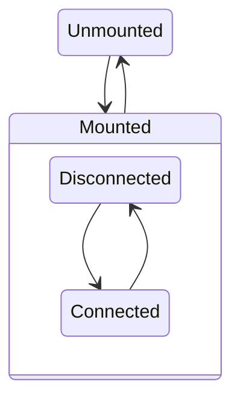

# `anymount`

[](https://codecov.io/gh/esdandreu/anymount)

Mount cloud storage as local filesystems using platform-native APIs. Today,
storage providers offer both the storage service and the client software used to
access it. Storage providers have no incentive to build client software that
compresses on device in order to reduce transfer and storage costs. They are not
motivated either to include first-class end-to-end encryption features. The
software layer responsible for interacting with cloud storage should not be
owned by the storage provider, it should be owned by us.


> Working with agents is a lot about making sure the right context and tools are
  available to do the task. If both are covered, agents can get stuff done
  without you interfering. 
  [Ben's Bites - Jul 2,
  2026](https://www.bensbites.com/p/fable-is-back)

Harnesses are optimized for local storage handling. Re-using that interface to
access any storage allows agents to access your data more effectively and more
efficiently.

## Quick Start

### mise-en-place

This project uses [`mise`](https://mise.jdx.dev/getting-started.html) to manage
dev tools, environments and tasks.

### Commands

`connect NAME` mounts a named configuration in the foreground. `connect --all`
mounts all configured records. Local storage needs no OAuth authorization.

OneDrive interactive native authorization uses a public-client device flow and
saves credentials into the selected configuration, preserving its format and
unrelated mount and driver fields. The host owns the Microsoft registration:
enable public-client device authorization for the supported account types.
The legacy built-in client ID remains the default, but its current registration
and live consent have not been verified.

Authorize a named record in an explicit configuration directory:

```bash
mise run anymount -- --config-dir /path/to/config auth demo
```

Connect that record:

```bash
mise run anymount -- --config-dir /path/to/config connect demo
```

Build the release binary (`target/release/anymount-cli`):

```bash
mise run build
```

### Build options

Copy `.env.default` as `.env` and edit it to set build options.

## Mounts



- **Unmounted**: Configuration might exist but there is no artifact associated
  to it on the system. For example, there is no Sync Root registered on Windows.
- **Mounted**: The system contains artifacts associated to the mount. But the
  mount doesn't necessarily have a live connection.
  - **Connected**: The mount has a live connection to the storage provider. For
    example, on Windows the Cloud Filter driver is running and providing
    callbacks for filesystem events.
  - **Disconnected**: The mount has no live connection to the storage provider.
    For example, on Windows the Cloud Filter driver is not running and there are
    no callbacks for filesystem events.


## Architecture

`anymount` is organized around three layers.

- `domain` models driver concepts and invariants. It owns driver,
  storage, and telemetry specifications without filesystem, UI, or platform
  code.
- `application` implements use cases such as `connect`, `connect-sync`, `auth`,
  `status`, and config updates. It orchestrates work over domain types and
  internal ports.
- Adapters live at the edges. CLI and TUI handle input and output, `config`
  persists named drivers, `telemetry` builds observability, `auth`
  handles external authorization flows, `service` hosts long-running
  driver processes and control transport, and `drivers` / `storages`
  integrate with platform APIs.

Dependency direction flows inward: frontends call `application`,
`application` works in terms of `domain`, and adapters implement the
external details around those layers.

Storage implementations return directory entries through the domain `DirEntry`
trait. Each storage implementation defines its own entry type.
Storage configurations are saved data. `StorageConfig::open_session` creates
an independent live session; clone the session handle to share it across
connections. `ConfigDir` returns a `LoadedConfig` that keeps the saved
configuration, its session, and any host persistence separate.

OAuth interaction is asynchronous and host-owned through `domain::Authorization`.
OneDrive uses one portable implementation for native and browser requests.
Storage reads never open a browser or save configuration. Native mounts save
renewed snapshots independently; browser hosts use `OneDriveBrowserApi` and its
`savePending` callback. Save only the provider-designated paths, leaving
unknown fields and siblings untouched.
Usable in-memory credentials do not wait for saves. `pending_update` retains
the newest snapshot, and failed saves can be retried without refreshing again.
Do not cancel a custom persistence task while its external write can still
complete; native and exported browser hosts serialize in-flight writes.

Access and refresh tokens remain secret-bearing fields in local configuration.
Copying a configuration copies its credentials; sharing or exporting it can
expose access to the account.
Expiry and scopes come from OAuth responses, not access-token JWT decoding.
Unknown-expiry and access-only tokens are usable until provider rejection.
Fresh sign-in replaces the whole grant; an omitted refresh token is preserved
only during renewal of that same grant. Binding metadata prevents silently
reusing a grant after changing its client or resource. Supported resource
endpoints are Microsoft Graph `https://graph.microsoft.com/v1.0` and `/beta`;
arbitrary bearer destinations and other cloud authorities are unsupported.

Browser deployments must supply their own public SPA `client_id` and registered
redirect URI. The shared public-client PKCE flow uses Microsoft's `common`
authority, delegated `Files.ReadWrite` and `offline_access`; account types,
consent, redirect origin, and token/resource CORS must match that registration.
There is no embedded client secret or required Anymount backend. No claim is
made that the built-in registration or every provider works in every browser.
Device flow is available only when the deployment permits its endpoints.
Browser filesystem permissions remain a separate API.

`OneDriveBrowserApi.beginRedirect` retains the newest bounded, short-lived
continuation in this tab's sessionStorage. After navigation, restore it into the
same configuration identity using `resumeRedirect`. `completeRedirect` validates
the callback before consuming that record, removes it before exchange, and clears
callback query parameters from the address bar. Never put continuations into URLs
or long-lived configuration. Cancelled, expired, superseded, mismatched, and
replayed callbacks are rejected. Hosts must prevent concurrent owners of the same
saved record across processes or tabs; no distributed coordination or crash-safe
provider/local-save transaction is promised. Failed renewal results remain shared;
`Authorization::retry_renewal` (browser `retryRenewal`) explicitly permits another
exchange only after a temporary failure. Requests have a 60-second deadline;
browser timer throttling can delay it in suspended tabs. Ambiguous exchanges are
never replayed automatically. A restart can require fresh sign-in when rotated
credentials were not saved.

OneDrive browser downloads obtain the provider's preauthenticated metadata URL
instead of following authenticated `/content` redirects. These URLs are secrets;
download requests never carry bearer credentials. Authorization, configuration,
and error debug output redact tokens, codes, callback queries, and raw responses.
Device codes are displayed intentionally only as sign-in instructions.

Range reads accept `futures::io::AsyncWrite + Unpin` sinks, including
`WriteFileSession` directly. Requested source bytes are written sequentially at
the sink's current position, independently of the source offset. Reads await
partial writes and backpressure, but never flush, close, finish, or abort the
caller-owned sink. Storage reads return the copied byte count, including short
reads at EOF; the `read_file_at` helper requires the entire requested range.
Sink failures retain their `std::io::Error` in `ReadFileAtError::Write`.

Writable storage starts a `WriteFileSession` through `Storage::start_write_file`.
Startup failures return `StartWriteFileError`; session failures use
`WriteFileError`.
Sessions implement `futures::io::AsyncWrite` with incremental backpressure;
neither flush nor close commits a file. Close seals input. Call `finish` to
finalize any transforming wrappers before committing downstream, or await
`abort` to discard staged output. Dropping a session cannot await cleanup, and
canceling a finish cannot undo a commit already submitted to the provider.
The browser adapter supports these writes; Local and OneDrive remain read-only.

## Notable dependencies

### Windows
- [**windows-rs**](https://github.com/microsoft/windows-rs) - Official
  Microsoft Rust bindings
- [**cloud-filter**](https://github.com/ho-229/cloud-filter-rs) - Cloud Filter
  API wrapper

## Testing

Run the full suite:

```bash
mise run test
```

## Roadmap

- [x] Storage write interface.
- [x] Storage OAuth interface and OneDrive authorization.
- [ ] Local storage.
- [ ] FUSE driver.
- [ ] OneDrive storage.
- [ ] S3 storage.
- [ ] GDrive storage.
- [ ] Interface for mount management. List mounts, connect/disconnect, edit existing mounts and add new ones.

## License

LGPL-3.0-or-later - See [LICENSE](LICENSE) and [LICENSE-GPL](LICENSE-GPL).
